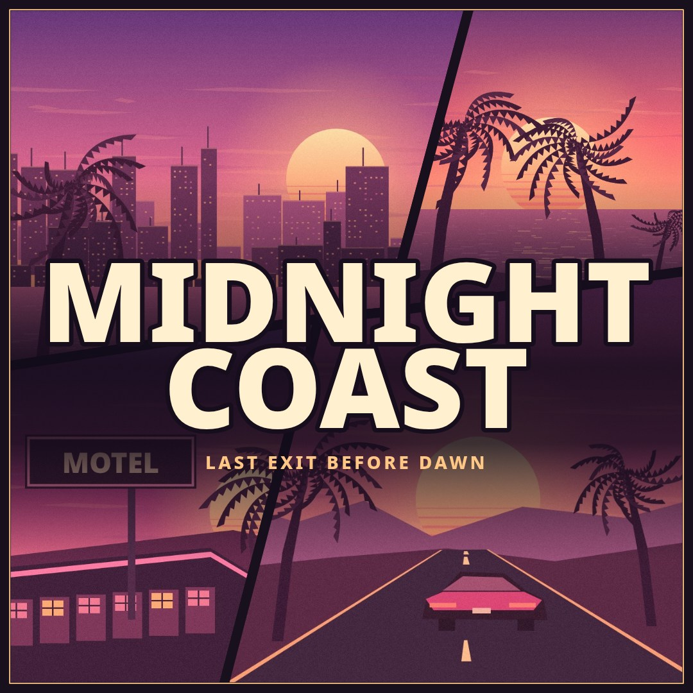

# Afterlight Cover Studio

[](https://make.fun/bounty/gta6-cover-art-01?utm_source=github&utm_medium=readme&utm_campaign=gta6-cover-art-01)
[](https://make.fun/bounty/gta6-cover-art-01/leaderboard?utm_source=github&utm_medium=readme&utm_campaign=gta6-cover-art-01)
[](https://make.fun/bounty/gta6-cover-art-01?utm_source=github&utm_medium=readme&utm_campaign=gta6-cover-art-01)

Afterlight turns your photos into an angular cover-art collage. It opens with four original, procedurally drawn scenes from a fictional coastal city.



## Make a cover

1. Open `app/index.html` in a modern desktop browser. You can also run `node serve.ts` and open `http://localhost:8080`.
2. Pick a square, portrait, or wide canvas and a two-, three-, or four-panel layout.
3. Select a numbered panel and choose **Replace photo** to use an image from your device. Drag the image in the preview or use the zoom and position controls to crop it.
4. Enter a title and subtitle, and choose Sunset, Neon, or Original color.
5. Click **Download PNG**. The selected format exports at 1080 × 1080, 1080 × 1350, or 1920 × 1080. Save a PNG before closing the editor to keep your work.

The editor runs offline. Photo decoding, cropping, grading, and export all happen in the browser, and the sample scenes are drawn locally with Canvas 2D.

## Package the entry

With Node.js 22 or later, run:

```sh
mkdir -p out && MAKEFUN_OUTPUT_DIR=out node main.ts
```

The make.fun runner writes the app, screenshots, and dossier into `out/`.
